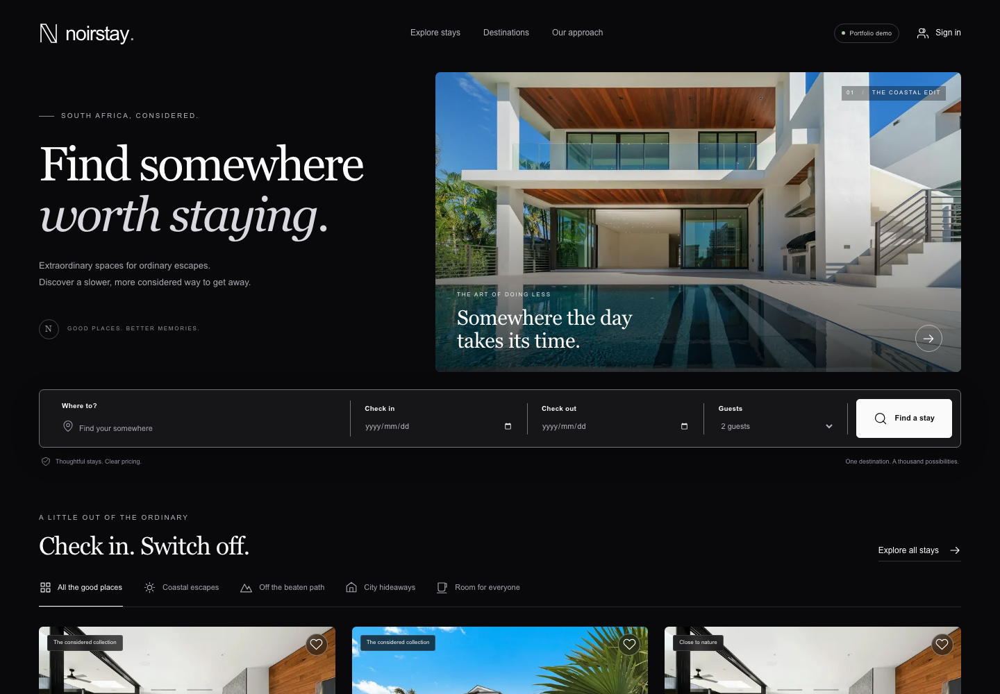
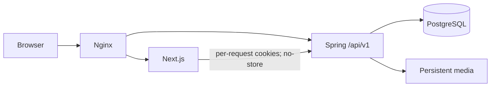

# NoirStay

**Find somewhere worth staying.**

An accommodation booking portfolio application by **Daniel Jr Nkulu**, for **Shape It
Solutions**. A new Next.js experience sits on a Java/Spring backend and PostgreSQL, with
original black-theme design and fictional South African stays.



This is a synthetic portfolio demo: no real accommodation is sold, no money is charged,
no card details are collected and no booking emails are sent. One listing is one
independently reservable unit, including an individual hotel room—not pooled room stock.

## Run it

Requires Docker with Compose. The original repository was renamed to `danmjrn/noirstay`, preserving history and branches.
The implementation is on its review branch:

```sh
git clone --branch feat/noirstay-portfolio https://github.com/danmjrn/noirstay.git
cd noirstay
cp .env.example .env
# Edit .env and replace DATABASE_PASSWORD with a unique local password.
docker compose up --build -d --wait
```

Local preview: **[http://localhost:3000](http://localhost:3000)**. The
[feature branch](https://github.com/danmjrn/noirstay/tree/feat/noirstay-portfolio) contains this
implementation; publication verification is recorded in [GitHub status](docs/GITHUB.md). No public deployment URL is claimed.

Choose **Portfolio demo → Demo guest**, **Demo host** or **Demo admin**. No shared password
is required. First entry creates your own synthetic data context; switching roles keeps
that context, so the host can see the guest's reservation. Account → Restore my demo starts
a fresh private context without resetting anyone else's data. Sessions survive backend
restarts. The explicit `demo` profile enables this; normal startup creates no demo users.

For separate Java/Next development, configurable ports, environment variables, migration
permissions, backups, deployment and rollback, see [the operations guide](docs/DEPLOYMENT.md).

## What works

- Destination/date/guest search, price/type/amenity/rating filters, URL state, stable sorting
  and pagination; responsive galleries, availability, rules, fictional reviews and full prices.
- Registration, session login/logout, account editing, saved stays and persisted trips.
- Server quotes, ten-minute inventory holds, policy acceptance, deterministic payment
  simulation, confirmation, cancellation/refund previews and eligible one-per-stay reviews.
- Host draft/edit/submission forms, validated local photograph uploads, date blocks/unblocks,
  reservations and metrics derived from persisted data.
- Context-scoped administrator publication/unpublication, user/booking/payment inspection
  and publication audit history. Historical trips remain after listing changes.
- 24 fictional stays across Cape Town, Johannesburg/Sandton, Durban, the Garden Route and
  Drakensberg, with completed/future reservations, demo reviews and blocked dates.

The [five-minute walkthrough](docs/WALKTHROUGH.md) demonstrates the guest → host → cancellation
journey. [Our approach](http://localhost:3000/about) explains the engineering separately from
ordinary booking screens.

## Technology and layout

Java **21 LTS**, Spring Boot **4.1.2**, Gradle **8.14.3**, PostgreSQL **18.6**, Next.js
**16.4.3**, React **19.3.1**, strict TypeScript **6.0.3**, Tailwind **4.3.3** and pnpm
**11.12.0**. See [version selection and official references](docs/TOOLCHAIN.md).

```text
backend/          Spring MVC, Security/JPA, migrations, services and PostgreSQL tests
frontend/         Next.js App Router, typed API client, feature components and browser tests
infrastructure/   Single-origin Nginx and loopback-only development overlay
scripts/          Authenticated restart/persistence smoke probe
docs/             Architecture, walkthrough, case study, evidence, operations and assets
```



[Architecture and entity diagram](docs/ARCHITECTURE.md) covers module boundaries,
constraints, deletion behaviour, authentication, isolation and engineering tradeoffs.

## Reservations that keep their promise

Stays occupy **[check-in, check-out)**, allowing back-to-back reservations. A single
PostgreSQL GiST exclusion constraint protects active holds, confirmed stays and host blocks.
Transactions lock the listing before a booking, and coordinated tests exercise competing
requests. No current-time expression appears in the constraint: expiry explicitly changes
booking/inventory state, including after restarts.

Five-minute quotes record a price version; obtaining a hold after expiry or a price change
requires renewed consent. A valid hold honours its agreed price for ten minutes. Final
confirmation rechecks ownership, expiry, publication, dates and capacity. Payment simulation
and confirmation commit atomically. Persisted user/operation idempotency keys replay identical
requests and reject conflicting reuse. Cancellation atomically records one refund and
releases dates. Spring owns all identity, status, inventory and money decisions.

Pricing uses `BigDecimal`/`numeric(12,2)` and HALF_UP rounding: nightly rate × nights,
one cleaning fee, 8% service fee, then 15% demo VAT on their sum. Currency is explicitly ZAR.
Flexible cancellation refunds 100% at 2+ calendar days before arrival; moderate refunds
100% at 7+ days and 50% at 2–6 days; later cancellation refunds zero. These percentages apply
to the agreed full total, including fees/tax. The server recalculates the refund at cancellation.

## Verify it

With Java 21 and Docker running:

```sh
cd backend
./gradlew test bootJar --no-daemon
```

With Node 22.13+/24 and pnpm 11.12.0:

```sh
cd frontend
pnpm install --frozen-lockfile
pnpm lint
pnpm typecheck
pnpm test
pnpm build
pnpm exec playwright install chromium
pnpm test:e2e
```

Browser tests use the running preview, create synthetic records and capture real screenshots.
[Verification evidence](docs/VERIFICATION.md) records exact results, screenshots, restart
rehearsal and any remaining gaps. GitHub Actions defines backend, frontend and Compose/browser
jobs; no remote CI result is claimed before it actually runs.

Live API contracts: [OpenAPI JSON](http://localhost:3000/api/v1/openapi) and
[Swagger UI](http://localhost:3000/api/v1/docs). Protected mutations use the HttpOnly `SESSION`
cookie and a CSRF token from `/api/v1/auth/csrf`. Booking transitions additionally require an
`Idempotency-Key`. [API examples](docs/API.md) describe the actual checkout contract.

## From the original project

The same Git history is preserved. MySQL, doubles and legacy date arithmetic were replaced;
UUID repository typing, ownership, overlapping inventory, entity request bodies, hardcoded
guest identity and unconditional privileged initialization were corrected. Unused view,
reactive, AWS, Lombok and JWT dependencies were removed. Current source uses environment
configuration and a functional persistent media adapter; it needs no AWS account.

No MySQL dataset was supplied and no existing customer-data migration is claimed. The
inherited source contained database credentials, AWS credential configuration, JWT signing
material and demo account credentials. Revoke/rotate any previously used values; this work
does not reproduce them, rewrite history or rotate unrelated infrastructure credentials.

The [portfolio case study](docs/CASE_STUDY.md) distinguishes inherited foundations from the
new implementation. [The audit checklist](docs/IMPLEMENTATION.md) records the transformation.

## Deliberate limits

This is a single-instance portfolio release with flat nightly rates, ZAR only, local media,
simulated payments/email and operator-managed demo-context retention. Login/context throttles
are in memory. Host/admin identities in a normal, non-demo deployment require deliberate
operator provisioning. There is no pooled inventory, multi-room checkout, real property
verification, dynamic nightly pricing, currency conversion or measured production capacity.
The deployment guide requires an explicitly authorized TLS target; none was supplied here.

Photographs are licensed illustrative [Unsplash assets](docs/ASSETS.md). Wordmark/favicon/
social artwork are original. Real application captures are in `docs/screenshots/`.
Inherited attribution is preserved in [NOTICE](NOTICE) and Git history. The original checkout
had no licence file; no new licence grant is invented. GitHub rename, metadata and PR verification
are documented in [GITHUB.md](docs/GITHUB.md).
