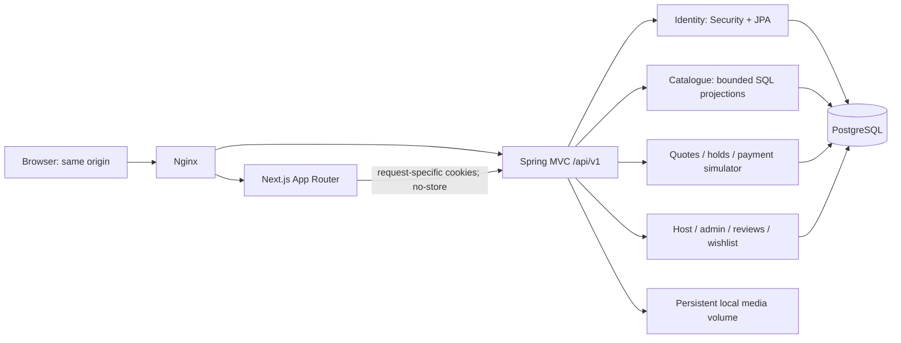
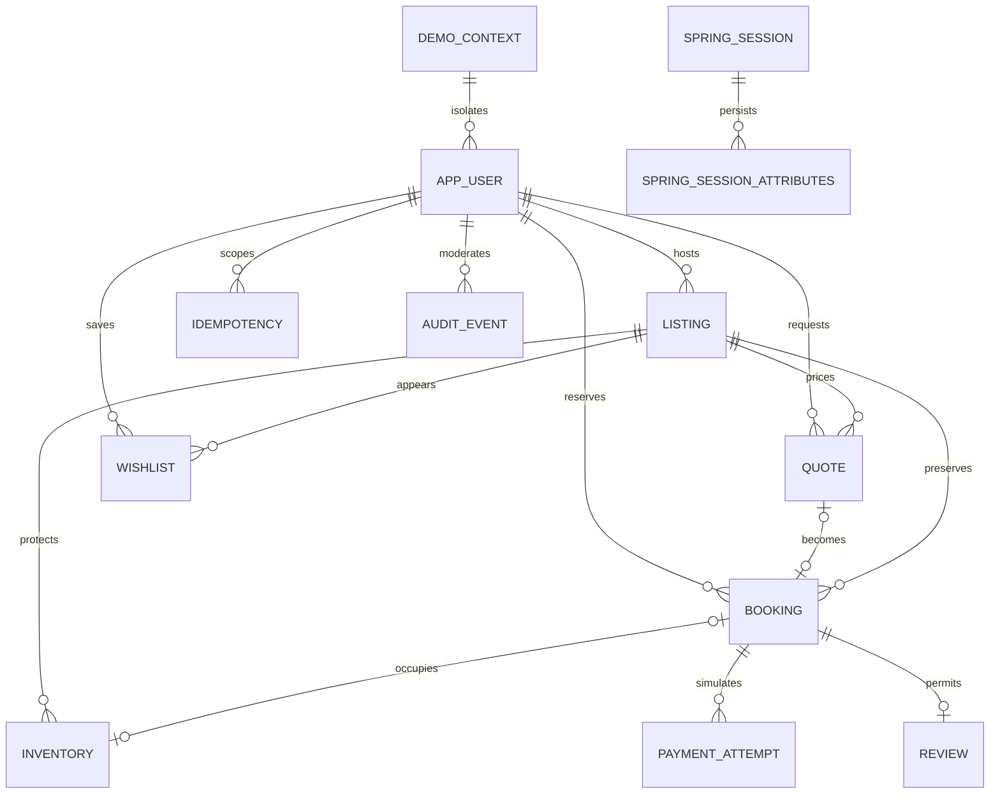
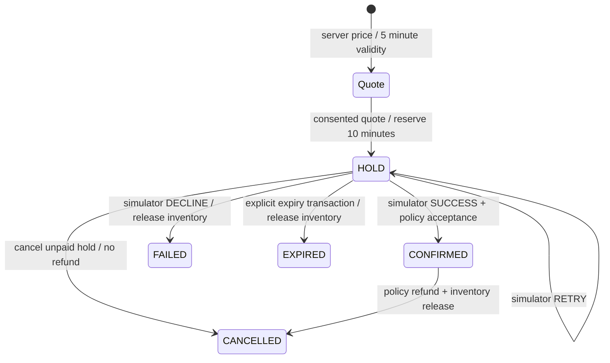

# Architecture and invariants

Sundrift is a modular monolith, with one Next.js frontend and one PostgreSQL database.
One listing is one independently reservable unit. Pooled room inventory, multi-room
reservations, currency conversion, real payments and commercial property verification
are outside this release.

The identity module uses Spring Data JPA with UUID identifiers. Explicit SQL projections
and commands serve the catalogue and reservation modules. This keeps PostgreSQL-specific
range, advisory and row locks visible, bounds catalogue query counts, and avoids entity
serialization/N+1 queries. Spring's transaction manager binds JPA and JDBC to the same
datasource. `Database` returns safe DTO projections; password hashes never enter API responses.

Catalogue amenities and photographs are bounded JSON arrays rather than separate lookup
entities. The relational IDs and historical booking/quote/payment references use restrictive
foreign keys. Wishlist relations can cascade on deletion; historical reservation data does
not cascade away. No destructive listing/user deletion endpoint exists. Unpublication
changes discoverability and future booking eligibility, not historical trip data.

## Inventory

All dates use `LocalDate`; timed events use UTC instants. Dates are interpreted in the
listing's `Africa/Johannesburg` time zone. A stay occupies `[check_in, check_out)`.
Check-in may be today or within 365 days; length must be 1–30 nights; capacity must be
1–16 and cannot exceed the listing. Back-to-back stays do not overlap.

`inventory` contains both reservation inventory and host blocks. Its PostgreSQL GiST
exclusion constraint rejects overlapping active ranges for a listing, independently of
who requests them or which application instance handles them. `btree_gist` is installed
by Flyway; the migration role needs `CREATE` on the application database. On a restricted
managed database, an operator can install that trusted extension before migrations.

Every inventory mutation acquires a listing row lock before booking row locks. This
serializes service-level decisions, while the exclusion constraint is the final invariant.
Host blocks follow the same lock order and constraint. SQLSTATE integrity conflicts map to
HTTP 409. Coordinated tests prove independent competing transactions cannot both succeed.

## Lifecycle and retries

A quote records a price version; expiry or changed listing prices require a new quote
before obtaining a hold. Once held, the agreed snapshot is honoured for ten minutes,
including the original price and cancellation policy. Client totals, status, user IDs
and payment outcomes are not accepted. The simulator accepts only named test scenarios;
Spring computes and persists the resulting state and amount.

A 30-second worker processes expired holds, including after restarts. Reservation commands
also release expired holds for the affected listing inside their transaction. Confirmation
locks the listing and booking, rechecks ownership/state/expiry, then records the simulator
attempt and confirms atomically. The exclusion predicate is only `active`, never `now()`.
Expiry explicitly sets inventory inactive and the booking expired in one transaction.

Persisted idempotency keys are scoped to user + operation + key, with a SHA-256 payload
fingerprint and saved JSON response. A transaction-scoped PostgreSQL advisory lock
serializes simultaneous identical retries. Matching retries replay the original outcome;
different payloads receive 409. A new simulator attempt uses a new key. No idempotency row
is committed for a rejected command. Payment success, decline, cancellation and refund
records commit with their associated state/inventory transition. Duplicate cancellations
cannot issue a second refund. Terminal states cannot be revived.

## Pricing and refunds

`BigDecimal` and `numeric(12,2)` are used for money. Each component is rounded HALF_UP
to two decimal places before summation. Currency is explicitly ZAR.

- Accommodation = nightly rate × departure-exclusive nights.
- Cleaning = one fixed stay fee.
- Service = 8% of accommodation.
- VAT = 15% of accommodation + cleaning + service.
- Total = the rounded sum of those four components.

Example: R999.99 × 2 nights = R1,999.98; cleaning R350.00; service R160.00;
VAT R376.50; agreed total R2,886.48. These are deliberately simple demo pricing rules,
not tax advice or a claim about a real accommodation business's VAT obligations.

Refund percentages apply to the whole agreed total, including fees/tax. Flexible:
100% at least two calendar days before arrival, otherwise zero. Moderate: 100% at seven
or more days; 50% at two through six days; otherwise zero. An unpaid hold has no refund.
Cancellation is allowed through the arrival calendar date; a past arrival date is rejected.
The preview is recomputed on cancellation. Reviews open on/after checkout for confirmed
stays and are unique per booking. Cancelled, held, failed or expired stays cannot be reviewed.

## Authentication and isolation

Spring Security uses HttpOnly, SameSite=Lax cookies and synchronizer-token CSRF protection.
Obtain a CSRF token before every mutation, including entry/login/logout. HTTPS deployments
must set `COOKIE_SECURE=true`. Sessions and their CSRF/demo-context attributes are stored
in PostgreSQL, so restarting an application instance does not orphan a visitor's context.
Logout invalidates the server session. No authentication material is put in local storage.

The frontend forwards only the current request's cookies during server rendering and uses
`cache: no-store`. There is no cross-user server cache. The deployed edge provides a single
origin; no cross-origin browser API access is enabled or needed. The backend/database are
internal. Development-only loopback ports are in a separate Compose overlay.

Normal startup has no demo fixtures and no passwordless demo controllers. Operators must
provision their own host/admin identities outside public self-registration. The explicit
`demo` profile seeds an anonymous showcase once. Demo entry creates a visitor-specific set
of 24 listings, 3 identities, completed/future reservations, reviews and blocks. Role switching
retains that session's context. Demo administration cannot inspect a different context or
normal registered users. Registered guests in demo mode also receive an isolated catalogue.
The account restore action starts fresh data for that visitor; there is no global reset API.

Login/registration are limited to 20 attempts per IP/minute in this single-instance release.
New demo contexts default to 10/IP/hour. These in-memory throttles reset on application
restart; durable inventory correctness does not depend on them. A local regression setting
can raise `DEMO_CONTEXTS_PER_HOUR`; do not use that setting on an exposed demo.

## Storage and operations

JPEG/PNG uploads are limited to 5 MB, 10,000–24,000,000 pixels and twelve images per listing.
The adapter validates decoded content and dimensions before full decoding, re-encodes to
PNG, strips original metadata, assigns a random server filename and stores it under one
persistent root. Submitted filenames/paths are never used. Re-encoding a bounded source can
produce a larger stored PNG; disk quotas are a VPS operational concern. Removing a photograph removes only that listing’s reference; media files and shared fixture
assets are retained. Removing the final photograph returns the listing to draft. A failed transaction
after writing a file may also leave an unreferenced file; operator reconciliation is future work.

Significant publication changes create audit records. Safe health/readiness endpoints
expose no configuration. Structured request logs contain method, status, duration and a
server-generated correlation ID, never cookies, request bodies, passwords or personal data.
The edge hides health endpoints from public routing.
